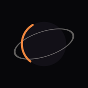
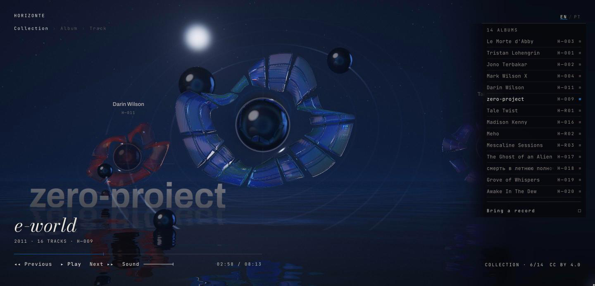
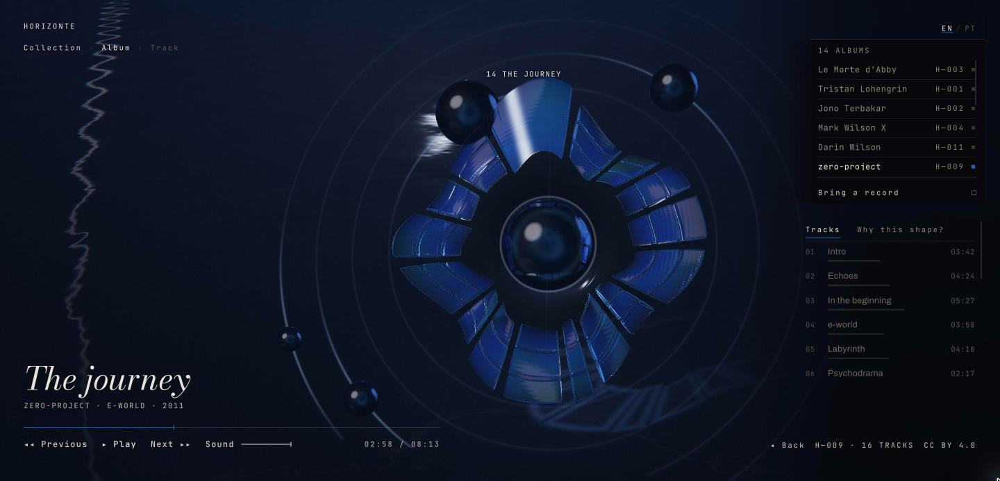
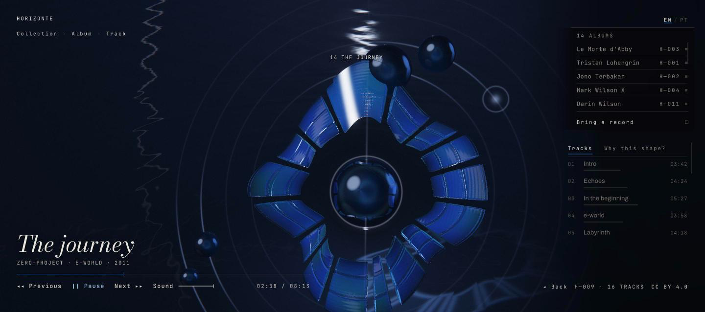

<h1 align="center">
  <br>
  
  <br>
  Horizonte
  <br>
</h1>

<h4 align="center">A music player where the music has mass, and mass bends space.</h4>

<p align="center">
  
  
  
  
  
  
  
</p>

<p align="center">
  <a href="#-features">Features</a> •
  <a href="#-the-field-engine">Field Engine</a> •
  <a href="#-the-sensory-signature">Sensory Signature</a> •
  <a href="#-tech-stack">Tech Stack</a> •
  <a href="#ℹ%EF%B8%8F-how-to-run-the-application">How To Run</a> •
  <a href="#-license">License</a>
</p>

<p align="center">
  Every record is a glass sculpture standing over a night sea — no meshes, no models, a shape ray-marched in a fragment shader. Every album carries its own physics, measured from its own audio.
</p>

<p align="center">
  🔗 <strong>Live demo:</strong> <a href="https://horizonte.marianacastro.dev">horizonte.marianacastro.dev</a>
</p>

<p align="center">
  
</p>

<br/>

## 🌌 Features

|                              |                                                                                                                                                                       |
| ---------------------------- | --------------------------------------------------------------------------------------------------------------------------------------------------------------------- |
| **🔮 Glass Over a Night Sea** | Every record is a glass sculpture ray-marched as a distance field — no meshes, no models — refracting the moon and reflected in the water. The original gravitational-lens renderer is kept at `/?classic`. |
| **🖱️ Cursor With Mass**       | The pointer presses on the sea under it and carries a small light in the record's ink. Picking a record or a track is a ray cast from the same camera into the same bodies the shader draws. |
| **🔭 Scales, Not Screens**    | Collection → album → track is one camera moving between three rigs, interpolated continuously — never a route change or a mounted/unmounted view.                      |
| **🪐 Orbit**                  | Inside an album or a track, drag to orbit the record and use the wheel or a pinch to zoom. Left alone for 6.5s, the camera eases back to its framing.                  |
| **💥 Collapse & Fusion**      | Play runs a 2.25s collapse inside the same world: the light hushes instead of cutting to black, then the core flashes, a ring crosses the sea and a jet fires. Skipping runs a 1.6s fusion where a seed of the incoming track spirals into the core. |
| **🎛️ Instruments Layer**      | Controls live in a separate DOM layer that is mono, never deformed and always clickable. After 2.6s of stillness the secondary parts fade to 32%, sound only softens to 80%, and transport, time, the collection counter and the focused record stay fully legible. Controls (transport and sound) are set larger and heavier than the information beside them, so they read as actions at a glance. No action depends on a keyboard shortcut. |
| **🔊 Real Audio Analysis**    | `HTMLAudioElement` → `AnalyserNode` → three bands that strike the crown where the music is playing and travel around it as waves. Each band's lift is capped (7%, 5% and 3% of the body's radius) and the drive is scaled by the record's own dynamics, so a compressed record moves less than a dynamic one. |
| **🧬 Per-Album Physics**      | Each album's loudness, dynamics, brightness, length and pulse are measured offline and become the constants and the shape of its world — playback only perturbs them. |
| **🔍 Why This Shape?**        | A view beside the track list reads each record's shape back to its music as questions about what you see, isolates that part of the world, and lets you set one descriptor to the catalogue median to watch the shape respond. |
| **🌐 Two Languages**         | The whole experience — instruments, measurement, announcements and the "Why this shape?" questions — exists in English and Brazilian Portuguese, picked from the browser and switchable in place without touching playback. |
| **📀 Bring Your Own Record**  | Drop your own files and the same DSP runs **in the browser**, in a worker, producing the same `AlbumSignature` the curated catalogue gets. Nothing is uploaded — no backend, no CDN, no API. |
| **⚖️ Licensed Curation**      | Fourteen real albums — twelve CC BY 4.0 and two CC BY-SA 4.0 — each verified at the source by a pipeline that aborts on any license mismatch, with attribution surfaced in the UI.                 |
| **♿ Accessible By Design**   | Real `button` / `ul` / `li`, `aria-current`, `aria-pressed`, `role="progressbar"`, `aria-live`, visible keyboard focus, and a full `prefers-reduced-motion` path.       |

<br/>

## 🖼️ Screenshots

<table>
  <tr>
    <td align="center" width="50%"><strong>Album — one glass plate per track</strong></td>
    <td align="center" width="50%"><strong>Track in progress</strong></td>
  </tr>
  <tr>
    <td valign="top"></td>
    <td valign="top"></td>
  </tr>
</table>

<br/>

## 🛠️ Tech Stack

<p>
  
  
  
  
  
  
  
  
  
</p>

| Category          | Technologies                                                              |
| ----------------- | ------------------------------------------------------------------------- |
| **Framework**     | Next.js 16 (App Router), React 19                                         |
| **Language**      | TypeScript 5                                                              |
| **Rendering**     | three.js 0.185 (`RawShaderMaterial`, full-screen triangle), custom GLSL ES 3.0 — a ray-marched distance field, half-float targets, bloom, light shafts, filmic tone map |
| **World text**    | Canvas 2D for the artist's name, placed in the scene as a texture; DOM for the title, sector labels and captions, projected through the same camera |
| **Audio**         | Web Audio API (`AnalyserNode`, FFT 1024) over `HTMLAudioElement`           |
| **Styling**       | Tailwind CSS v4 (instruments and overlay — the world is WebGL)             |
| **Typography**    | Archivo, Bodoni Moda, JetBrains Mono — self-hosted via `next/font`         |
| **Media**         | `public/music`, or a CDN base via `NEXT_PUBLIC_MEDIA_BASE_URL` (Vercel Blob in production) |
| **Offline Tools** | Python 3 + NumPy + Pillow (curation, audio analysis), `afconvert`          |
| **In-Browser DSP**| Web Worker, `OfflineAudioContext`, hand-written real FFT (no dependencies) |
| **Tooling**       | ESLint, TypeScript strict mode, Vitest, GitHub Actions                    |

<br/>

## 📝 Project Description

Horizonte is a spatial music experience built on one idea: **music has mass, and mass bends space.**

Every record is a glass sculpture standing over a night sea. Nothing in it is modelled: the body is a distance field assembled from what was measured in the record's audio — a crown with one plate per track, a dark core, satellites on their orbits — and ray-marched in a fragment shader that refracts the moon through the plates and reflects the whole body in the water. In the collection, the artist's name stands in the same scene, behind the focused record. The original renderer, where one gravitational-lens shader bends two 2D canvas planes, is kept at `/?classic` and runs off the same engine and the same signatures.

Navigation is a change of physical scale rather than a change of screen. Collection, album and track are the same world seen by one camera that moves between three rigs, interpolated continuously — nothing mounts or unmounts. A separate **instruments layer** (mono, 10.5px, drawn in the DOM) guarantees every fundamental action stays clickable and legible, including during the collapse.

**Additional features:**

- **The field engine:** The flagship piece. See the [dedicated section](#-the-field-engine) below — a state machine that treats collapse and fusion as physical events rather than transitions, and hands each frame to a renderer it knows nothing about.
- **Sensory signatures:** Each album's audio is analysed once, offline, into loudness / dynamics / brightness / duration descriptors that become that album's field constants — see the [dedicated section](#-the-sensory-signature).
- **Decoupled audio pipeline:** `audio source → playback → analysis → visual state → Horizonte`. The scene never touches an `<audio>` element or an `AnalyserNode`; it reads a plain `VisualAudioState` (energy, three bands, accent, spectral flux, spectrum, progress). `AudioSource` is a discriminated union and `Playback` is an interface, so another provider can be added without touching the shader, the composition or the state machine.
- **Verified curation:** Fourteen albums from real artists — twelve **CC BY 4.0** and two **CC BY-SA 4.0**, whose share-alike obligation is documented per album — each verified at the source before download. The pipeline aborts if the declared licence doesn't match, if the download disappears, or if durations don't line up with the catalogue metadata. Six candidates were rejected on inspection — two declared contradictory licences on the same page, two were CC BY-**NC-ND** (no transcoding, no commercial use), one was a paid pack under a proprietary licence, one had no CC licence at all. Provenance, attribution, cover licensing and the exact modifications applied to each work are documented in [`CURADORIA.md`](CURADORIA.md).
- **Inks from the artwork:** Real covers arrive with wildly different exposure and palette. Two inks are extracted from each one and forced into `oklch(L .50–.62, C .13–.18)` — a narrow band that keeps the collection coherent — and they colour the glass and its light. The classic renderer also composites the cover itself into the ring: desaturated ~8%, overprinted with the album ink, given a shared grain, and exposure-equalised so a dark ambient sleeve still reads.
- **Bring your own record:** The same analysis that runs offline for the curated catalogue also runs **client-side**, in a Web Worker, over files the listener drops in. `analyze-audio.py` was ported to TypeScript and verified against it: fed identical PCM, the two produce **byte-identical envelopes on all fourteen albums**. End to end from the real `.m4a` files, the derived field constants land within **0.55% of each constant's range**. Files never leave the device — no upload, no backend, no external API. The full architecture, the parity measurements and the limitations are in [`docs/ingestao-local.md`](docs/ingestao-local.md).
- **Written twice, interpreted once:** What a shape says about its music is decided by one language-free module, and two writers — English and Brazilian Portuguese — turn that reading into questions with their own plurals, genders, ordinals and decimal marks. The rest of the interface reads from two typed dictionaries that share every key. The language follows the browser on a first visit, a boot script applies it before the first paint, and switching never interrupts playback. Details in [`docs/idiomas.md`](docs/idiomas.md).
- **Media served by path:** Audio and covers live under deterministic pathnames that mirror the catalogue (`/music/<album>/<track>.m4a`), from `public/music` or, in production, from Vercel Blob, served with HTTP Range (for seeking), permissive CORS (so the analyser isn't silenced and covers don't taint the canvas) and a one-year immutable cache. URL resolution is centralised in a single module; no absolute URL is hardcoded in a component.
- **Reduced motion:** With `prefers-reduced-motion`, the crown stays at rest, the ripples on the sea, the resting breath, the satellites' drift and the pointer's wake are switched off, the camera cuts between records instead of travelling, and the collapse and fusion are reduced to 300ms fades — **the state changes remain**, so nothing becomes unreachable. The light still follows the music.
- **Responsive compositions:** Desktop, tablet (rails collapse into a single column, ring labels reduced to the selected track) and mobile (one body per screen, drag becomes pagination, 48px touch targets).

<br/>

## 🌀 The field engine

`FieldEngine` is the brain — the state machine, the transport, the audio and the snapshot the instruments read — and it does not draw. Each frame it hands a plain `WorldView` (state, audio, the record's morphology, the strain that listening has left on it, the pointer) to a presenter:

```
step(dt) → world.frame(dt, view) → updateInstruments()
                  │
     scene ──────► bloom ──────► light shafts ──────► final
  (ray-marched    (five levels   (half resolution)   (filmic tone map,
   glass, sea,     down and up)                       vignette, grain)
   moon, name)
```

**There is no mesh.** Each record is a signed distance field built from its measured morphology: a crown of glass plates, one per track, whose outline, layers and breaks are baked into data textures; a dark core; and satellites on orbit lines. The shader marches that field, refracts the scene through the plates and reflects the body in the sea. Three bodies are alive at a time — the focused record and its two neighbours.

**One camera, three rigs.** Collection, album and track are three camera rigs blended continuously, and across the collection the camera travels along the row of records on a spring. Inside an album or a track the listener can orbit and zoom; left alone, the camera eases back.

**The music strikes the crown where it plays.** A damped ring of 128 nodes in three bands is driven at the playhead, so a bass hit lifts the plates of the passage being heard and the wave travels around the record from there. In quiet passages the record's resting breath shows through.

**The collapse is a sequence, not a transition.** Pressing play runs 2.25s inside the same world: the light hushes by about a sixth instead of cutting to black, the satellites wind up, and at 1.3s the core flashes, a ring crosses the sea and a jet fires.

**The fusion is the signature interaction.** Skipping to another track sends a seed of the incoming one spiralling into the core over 0.9s — then the core flashes, and the audio switches on exactly that beat.

**Performance is budgeted.** DPR is capped at 2 and the scene renders at an internal scale between 30% and 100%, retuned every 700ms from GPU timer queries (down above 11ms a frame, up below 6.5ms; frame time stands in where the extension is missing). Below 55% the march drops from 96 steps to 64.

**The classic renderer is still there.** `/?classic` runs the original one off the same engine: two offscreen 2D canvases — typography, album art, dust — bent by a single gravitational-lens fragment shader, one draw call and two texture uploads per frame.

<br/>

## 🧬 The sensory signature

Reacting to live audio is the easy half. The harder question is: **why should two albums feel different when nothing is playing?**

So the audio is analysed **once, offline** ([`scripts/analyze-audio.py`](scripts/analyze-audio.py)), and what a record *is* becomes constant:

| Measured        | Becomes                                                          |
| --------------- | ---------------------------------------------------------------- |
| **Loudness**    | Type weight (505–780) and the size of the dark core — heavy records sit heavier |
| **Dynamics**    | How hard live audio may drive the record, and how carved the outline is |
| **Brightness**  | How flat the body lies and how clear its glass is                |
| **Duration**    | Satellites around the body, and camera inertia across the collection |
| **Pulse**       | Layers in the ring and how fast the satellites circle            |
| **Track spans** | Real proportional widths of each sector in the ring              |
| **Pulse spread between tracks** | Breaks between the sectors                       |

Records also differ in how they move. While one plays, its **motion signature**, measured per track by [`scripts/analyze-motion.py`](scripts/analyze-motion.py) (attack sharpness, sustain, microdynamics and low-end weight), sets how fast the reaction rises and falls, how far into the record's ceiling a typical event reaches, and whether it moves the mass or the light. At rest, and for records brought by a listener, the response is neutral.

Two determinism guarantees hold the design together: every descriptor is normalised against **fixed absolute anchors** rather than against the other albums, so adding a record never changes anyone else's signature; and the fallback ink for achromatic covers is derived from **that album's own spectral balance**, never from its position in the list.

The result is the split the whole project rests on: **identity is measured and constant, reaction is live and bounded.** Playback only disturbs the shape: bass lifts the crown where the music is playing, mids and treble ride thinner bands, and each band's lift has a fixed ceiling (7%, 5% and 3% of the body's radius). Each record's own ceiling, measured from its dynamics (5% to 20%), scales how hard the music may push. Light, exposure and glow follow the music outside that ceiling. Never an equaliser, never bars, never a sphere pulsing on the beat.

The full mapping, with the calibrated ranges and the limits that keep records apart, is in [`docs/mapa-sensorial.md`](docs/mapa-sensorial.md).

The signature has **two producers and one contract**: `analyze-audio.py` measures the curated catalogue once, at curation time; `src/components/horizonte/ingest/` measures a listener's own record in the browser, during the session. Past `AlbumSignature`, the engine never asks where a record came from.

<br/>

## 🛠️ Engineering challenges

The hardest part was keeping the audio **physical rather than decorative**. It's trivial to make something pulse on the beat and it always looks cheap; the discipline was capping how far the music may move the shape, scaling that push by a ceiling the record itself sets, and pushing the real differentiation offline into measured constants.

Two failures were worth the trouble of catching. Migrating media to a CDN silently breaks `getImageData` — a cross-origin cover taints the canvas, and the cover exposure equalisation (which is what makes dark sleeves visible in the ring) throws `SecurityError` instead of degrading. I proved the behaviour against a local CORS-enabled origin before the migration rather than after. The second: a single negative frame delta was enough to drive the exposure lerp to `-Infinity` and then `NaN`, permanently blacking out the world — one clamp on `dt`, found only by driving the loop manually.

The curation pipeline also had to be genuinely defensive. It verifies the licence at the source on every run and refuses to proceed on a mismatch, because the tempting failure mode is to relax the check to reach a target number of albums.

<br/>

## ℹ️ How to run the application?

> Clone the repository:

```bash
git clone https://github.com/maricastroc/horizonte
```

> Install the dependencies:

```bash
npm install
```

> Rename `.env.example` to `.env.local` and fill it in.

`NEXT_PUBLIC_MEDIA_BASE_URL` is optional. When set, media is fetched from that base (the production deploy uses Vercel Blob); unset, it is served from `public/music`. Three albums are versioned there; the others are rebuilt locally by the media pipeline (see below).

> Start the service:

```bash
npm run dev
```

> Run the tests:

```bash
npm test                # unit and DOM suites, as in CI
npm run test:corpus     # parity and envelope tests over the local corpus
npm run test:all        # both, in sequence
```

The corpus tests read the WAV cache that `analyze-audio.py` leaves in `.cache/analysis`; without it they skip themselves. In development, `/parity` runs the same comparison in the browser.

> Type-check and lint:

```bash
npm run typecheck
npm run lint
```

> ⏩ Access [http://localhost:3000](http://localhost:3000) to view the application.

### Documentation

- [`docs/mapa-sensorial.md`](docs/mapa-sensorial.md) — how each musical descriptor becomes a physical property, within which limits.
- [`docs/ingestao-local.md`](docs/ingestao-local.md) — the in-browser analysis of a listener's own record and its parity with the offline pipeline.
- [`docs/composicao-mobile.md`](docs/composicao-mobile.md) — the mobile composition and its guardrails.
- [`docs/idiomas.md`](docs/idiomas.md) — the two languages: detection, the dictionaries and how the anatomy is interpreted once and written twice.
- [`docs/anatomia-pt-en.md`](docs/anatomia-pt-en.md) — every anatomy question for the fourteen albums, side by side in both languages (generated by `npm run anatomy:report`).
- [`CURADORIA.md`](CURADORIA.md) — provenance, licences and credits of every album (generated by `fetch-curation.py`).

### Rebuilding the media pipeline

Requires Python 3 with NumPy and Pillow, plus `afconvert` (bundled with macOS).

```bash
python3 scripts/fetch-curation.py    # verify licences, fetch, transcode, extract inks
python3 scripts/analyze-audio.py     # measure the sensory signature of each album
python3 scripts/analyze-motion.py    # measure the motion signature of each track
npm run media:upload                 # publish public/music to Vercel Blob
```

`fetch-curation.py` can rebuild the albums whose sources allow automated download. Albums distributed only through a manual flow are staged from `.cache/manual/<album>/` and reported as pending instead of being silently skipped. `media:upload` is incremental and verifies Range, CORS and cache headers before finishing.

<br/>

## 📄 License

Released under the [MIT License](LICENSE). You're free to use, study, fork and build on this code — **as long as the original copyright and license notice are kept**. Reuse it and learn from it; don't strip the attribution and present it as your own.

The **music is not covered by this licence.** Every album in the curation is licensed by its own artist under [CC BY 4.0](https://creativecommons.org/licenses/by/4.0/) or [CC BY-SA 4.0](https://creativecommons.org/licenses/by-sa/4.0/), and each one requires attribution on its own terms — see [`CURADORIA.md`](CURADORIA.md) for provenance, licences and the required credit for each work.

© 2025–2026 [**Mariana Castro**](https://marianacastro.dev) · [Live demo](https://horizonte.marianacastro.dev)

<br/>

<div align="center">

⭐ If you like this project, give it a star on GitHub!

</div>
